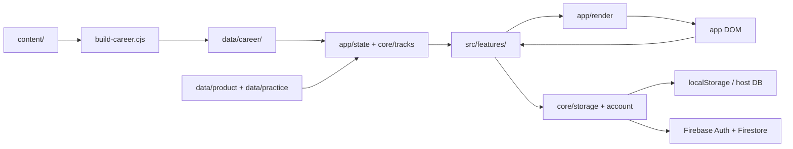

# PM English — архитектура и карта кода

Актуальность: 2026-11-20. Офлайн-режим опубликован через [PR #11](https://github.com/languages-with-cases/pm-english/pull/11), код [b2221c3](https://github.com/languages-with-cases/pm-english/commit/b2221c3534ff25b0edf35403cd3df2d58486a733). [Pages deployment](https://github.com/languages-with-cases/pm-english/actions/runs/44726990338) завершён 2026-11-20 11:22:31 UTC; живой HTTPS-сайт проверен с настоящим service worker и отключённой сетью. Описание соответствует структуре после реорганизации на базе [c6d5a78](https://github.com/languages-with-cases/pm-english/commit/c6d5a78344c40e8e5ff0f1a005a53d97875b0d00). Код текущей структуры опубликован как [67c4422](https://github.com/languages-with-cases/pm-english/commit/67c44220d9c0734fe20b7ae1a22fc098433d4487); выдача ресурсов и поведение проверены после успешного [Pages deployment](https://github.com/languages-with-cases/pm-english/actions/runs/44144849542) от 2026-11-17 18:10:35 UTC. Хронология и результаты проверок — в [Изменения.md](Изменения.md), правила работы — в [AGENTS.md](AGENTS.md), быстрый запуск — в [README.md](README.md).

## Концепция и неизменные данные

PM English обучает профессиональному английскому через рабочие решения, готовые ответы и разбор языка и профессиональной логики. Материалы и ответы преимущественно английские, инструкции и объяснения используют существующую двуязычную подачу. Пять независимых карьер: Product (`product`), Developer (`dev`), Project (`pm`), Analytics (`an`), Business Analyst (`ba`). У каждой семь глав, 91 узел в PLAN и 94 записи кейсов, включая дополнительные вне плана. Общий контент: 470 кейсов / 678 шагов.

Уровень состоит из кейса → tone → сборки фразы. На чётных уровнях 2/4/6/8/10/12 каждой главы Product, Project и BA третий этап заменён отдельной практикой: по 42 варианта, всего 126. Developer и Analytics пока сохраняют прежний третий этап. Отдельный каталог Additional содержит 15 заданий, по три на каждый трек. Ни ID, ни материалы, ни правила проверки/XP/открытия глав при реорганизации не изменились.

## Структура и технические решения

```text
index.html              # только оболочка и явные подключения
assets/images/          # бинарные картинки
assets/styles/          # CSS по слоям с сохранённым каскадом
data/career/            # генерируемый registry и пять треков
data/practice/          # авторские Additional и встроенная практика
data/product/           # статьи, событие, письма и тексты Product
data/                   # базовый словарь и метаданные треков
src/app/                # состояние, переходы, render, bootstrap
src/core/               # каталог, прогресс, сохранение, переключение треков
src/features/           # механики и представления отдельных разделов
src/ui/                 # общая навигация, иконки и scroller
content/                # авторские источники основной карьеры
scripts/                # генератор и проверка структуры
tests/unit/             # контракты и ключи данных
tests/browser/          # реальные сценарии и сравнение старой/новой версии
tests/helpers/          # загрузка registry и исторический сайт для теста
```

Приложение остаётся статическим и работает на GitHub Pages без сервера приложений и обязательной сборки. Node.js 20+ и npm используются только для инструментов. `npm ci` воспроизводит dev-зависимости из lockfile; `npm run dev` запускает Python HTTP-сервер. Стандартный стиль кода зафиксирован Prettier. Большие устаревшие объявления кейсов и LX больше не исполняются и не поставляются в HTML; единственный источник этих данных — генерируемые файлы карьеры.

Production JavaScript использует **classic scripts с defer**, не ES modules. Это сохраняет существующий контракт HTML-шаблонов с публичными обработчиками `onclick` и общим состоянием. Файлы разделены по ответственности, однако не имеют изолированного module scope: публичные функции и состояние доступны через общую браузерную область. Явный порядок в `index.html` является частью архитектуры; нельзя заменить `defer` на `async` или переставлять зависимости произвольно. CommonJS (`.cjs`) используется только в Node-инструментах и тестах.

Границы основного кейса и extras отделяют controller от view. Старые перехваты функций заменены явными точками продолжения: `preparation.js` предоставляет `startCase()/beginCase()`, затем вызывает `startCaseCore()/beginCaseCore()`; `render()` вызывает `renderScreen()`. Нет цепочки старых переопределений `render`, дубля `articlesView()` или скрытых копий всех кейсов в HTML.

## Загрузка и поток данных

1. Браузер получает HTML, параллельно загружает ресурсы; defer-скрипты выполняются после разбора DOM, по порядку подключений.
2. `data/career/index.js` создаёт CAREER_CONTENT, пять файлов регистрируют tracks. Остальные data-скрипты определяют Product-ресурсы, словарь, метаданные и практику.
3. `config.js`, иконки и каталог подготавливают общие зависимости; `app/state.js` получает Product-ссылки из канонических данных и строит начальные индексы. Core и features определяют обработчики/представления, tracks — переключение данных и упаковку состояния, account — существующий облачный слой.
4. Загружаются render и оба обработчика прокрутки. Последний файл `boot.js` создаёт снимок Product, запускает загрузку прогресса, восстанавливает выбранный трек, ставит `ui.loaded` и вызывает render. После этого запускается существующая Firebase-интеграция.
5. Действие игрока меняет `S`/`ui` через соответствующий feature/controller, вызывает `save()` при необходимости и затем `render()`. View строит HTML; обработчики остаются публичными функциями.



Материалы задач статические; ИИ и внешний API для оценки не используются. `select` сравнивает выбранные ID, `order` — один из явно допустимых порядков, `match` — пары ID с повторным использованием категорий. Ответы перемешиваются один раз на попытку, материалы сохраняют заданный порядок. Единственный движок — `src/features/practice.js`.

Встроенный вариант ищется по `track`, режиму `camp`, chapter/level и действительному месту case ID в PLAN. Цифра в case ID не равна номеру уровня. Совпадения case ID между треками допустимы. BA-вопрос может показывать заранее подготовленную response; процесс — иметь два шага и несколько явно допустимых порядков. `audit` служит независимым тестам, не отдельной runtime-оценке.

## Владение состоянием и сохранение

`app/state.js` владеет текущими `S`, `ui`, `store` и активными ссылками CASES/PLAN/LX. `core/tracks.js` владеет `TK`, `CUR_TRACK`, `STATES`, `TDATA`, `PMSNAP`: выбирает трек, перестраивает BYID/WORDS/FLAT и не продолжает попытку другого трека. `ui` — временное состояние экранов; прогресс сериализуется через `packAll()` в `{v:2, cur, st}`.

`core/storage.js` нормализует поля через merge(), читает старую одиночную Product-форму и текущий контейнер; persist()/flush() сериализуют локальные записи флагами saving/dirty. Облачная запись выполняется отдельно: cloudPending хранит последний снимок и uid, cloudWriting сериализует отправки. Ожидание Firebase не блокирует дальнейшие локальные сохранения; reconnect повторяет отправку. При смене uid проверяется владелец очереди. Очередь в памяти, долговечная копия — прежний localStorage; после нового входа используется существующее слияние. Основное локальное хранилище — localStorage. Сохранены ключи `pm-english-tracks-v2`, `pm-english-bank-v1`, owner key и `RESET_TAG=reset-2026-10-25`. Изменение reset tag вызывает сброс: это не номер релиза ресурсов.

Опциональная host-интеграция использует `window.claude.use(...)`. В обычном браузере работает локальное сохранение; Firebase Auth/Firestore (SDK 10.14.1) добавляет аккаунт и синхронизацию. В `users/{uid}` поле `all` содержит сериализованный контейнер, `data` сохраняет старую Product-форму, `updated` — время. Настройки web-клиента находятся в `src/config.js`; внешние правила Firestore и разрешённые домены этим репозиторием не определяются.

`better()` выбирает основной снимок по большему XP, при равенстве — по числу done. Это не покомпонентное объединение всех полей; practiceDone объединяется отдельно через practiceMergeDone() по известным ID. Вход другого аккаунта учитывает owner key. Эти границы не менялись.

Очки глав (`pts`, gradeScore) отделены от XP. Следующая глава требует завершения и `PASS_PCT=0.67`; уже пройденные главы сохраняются в pass. Additional не меняет знаменатель. Встроенная практика использует прежний слот `S.lx[caseId].b` и обычный бонус 3 XP с прежним правилом повторов; старое прохождение не даёт второй бонус. Собственный completion ID сохраняется и при нулевом новом XP. После трёх ошибок остаётся пропуск без бонуса.

## Авторские и генерируемые материалы

Изменения основного кейса вносятся в `content/`, затем `npm run build:content` обновляет шесть файлов `data/career/`. Источник исходных контрактов — `content/baseline.json`, извлечённый из неизменяемого коммита `a55e1ced315c6e73e2bcb1aa6cde55fd4bd044b1`. Его происхождение и контрольная сумма проверяются тестом. Генератор больше не исполняет старый HTML и не требует Git-истории для обычной генерации; baseline нельзя заменять текущими кейсами ради прохождения проверок. Файлы `.tsv` используют разделитель «вертикальная черта».

`data/practice/`, `data/product/`, `data/dictionary.js` и `data/tracks.js` авторские: генератор их не перезаписывает. Генерируемые файлы и авторские данные не форматируются общей командой Prettier; их форма уже читаема, а генерация должна оставаться детерминированной. Все исходные Product-статьи, письма, событие и onboarding сохранены как текущие данные, а не потеряны вместе с удалёнными черновиками кейсов.

## Где менять конкретное поведение

| Задача | Точка входа |
| --- | --- |
| Ответ/разбор основного кейса | Соответствующий `content/*.tsv`, затем генерация и unit-тест контента |
| Встроенное/Additional задание | `data/practice/` нужного трека, проверки его ключей |
| Смена этапа или XP урока | `features/cases/controller.js`, `features/lesson/controller.js`, `features/career-practice.js` |
| Новый общий вариант ввода | `features/practice.js` и его общие тесты; не отдельный движок на каждый трек |
| Разметка кейса или tone/build | Соответствующий `view.js` и слой стилей |
| Сохранение/старый прогресс | `app/state.js`, `core/storage.js`, `core/tracks.js`, `features/account.js` |
| Авторизация | `features/account.js`, `src/config.js`, реальные внешние настройки Firebase |
| Новые статья/письмо/событие | `data/product/` и feature с таким же назначением |
| Проблема прокрутки | `ui/scroll.js`, `ui/overscroll.js`, `assets/styles/lessons.css` |

Все пути в таблице относительно `src/`, если не указана другая директория. Ниже — полный каталог каждого файла репозитория, кроме служебного `.git` и установленных зависимостей.

## Полный каталог файлов

### Вход, инструменты и документы

| Файл | Ответственность |
| --- | --- |
| [index.html](index.html) | Оболочка страницы: meta, шрифты, семь таблиц стилей, упорядоченные defer-скрипты, splash и #app. Нет встроенных данных, CSS, JS или base64. |
| [package.json](package.json) | Версии dev-инструментов, поддерживаемый Node.js и команды запуска, генерации, форматирования и проверок. Это не runtime-сервер. |
| [package-lock.json](package-lock.json) | Точное дерево dev-зависимостей для воспроизводимого npm ci. |
| [.gitignore](.gitignore) | Исключения для node_modules, результатов браузерных проверок и локальных журналов. |
| [.prettierrc.json](.prettierrc.json) | Единый стиль форматирования: два пробела, двойные кавычки, ширина 100. |
| [.prettierignore](.prettierignore) | Исключает бинарные картинки, данные и авторские источники из автоматического переформатирования. |
| [README.md](README.md) | Быстрый старт разработчика, команды, навигация по документации и публикация. |
| [AGENTS.md](AGENTS.md) | Обязательный рабочий порядок для агентов: читать архитектуру/журнал, сохранять совместимость и записывать каждое изменение. |
| [АРХИТЕКТУРА.md](АРХИТЕКТУРА.md) | Текущая концепция, устройство сервиса и полный каталог файлов; обновляется при изменении контрактов или структуры. |
| [Изменения.md](Изменения.md) | Датированные изменения, причины, совместимость, проверки и остаток работы; новые записи сверху. |
| [PROGRESS.md](PROGRESS.md) | Этапы реализации и развёрнутые результаты проверок; старые разделы являются историей, а не текущим контрактом. |

### App, core и общие UI-компоненты

| Файл | Ответственность |
| --- | --- |
| [src/config.js](src/config.js) | Ключи хранилища, RESET_TAG, порог главы, награды и интервалы повторения; public web-config Firebase и URL SDK. Единственное место для этих параметров. |
| [src/app/state.js](src/app/state.js) | defaultState(), текущие S/ui/store и ссылки на активные CASES/PLAN/LX; начальные WORDS, BYID, AMAP, FLAT из канонических данных. |
| [src/app/navigation.js](src/app/navigation.js) | go(), переходы экранов, прокрутка к уровню, баннер главы и toast(). |
| [src/app/render.js](src/app/render.js) | renderScreen() выбирает представление по ui.view; render() добавляет переходы. padApp() учитывает навигацию, resize и загрузку шрифтов. |
| [src/app/boot.js](src/app/boot.js) | Единственная точка запуска. Снимок Product, загрузка состояния, проверка reset tag, восстановление трека, первый рабочий render и initCloud(). Загружается последней. |
| [src/core/catalog.js](src/core/catalog.js) | esc(), shuffle(), pick(), slug(); операции с уровнями, завершённостью кейсов и построением словаря allWords(). Не содержит материалов заданий. |
| [src/core/progression.js](src/core/progression.js) | Расчёт текущего узла, повторов, ежедневной цели и повышений; caseScore(), gradeScore(), gradePassed(), recPts() и правила открытия глав. |
| [src/core/storage.js](src/core/storage.js) | merge() нормализует старый прогресс; initStore()/persist()/flush()/save() выбирают host/local storage и сериализуют записи; resetTap() обрабатывает пользовательский сброс. |
| [src/core/tracks.js](src/core/tracks.js) | dataFor()/buildTrack()/applyTrack(), снимок Product; TDATA/PMSNAP/CUR_TRACK/TK/STATES; packAll()/loadAll()/mergeAlls()/remoteAll() и экран выбора трека. |
| [src/ui/home.js](src/ui/home.js) | Home, нижняя навигация, карточка серии дней и ссылки на игровые разделы. |
| [src/ui/icons.js](src/ui/icons.js) | Небольшие SVG для интерфейса и ссылки на изображения. Бинарные картинки не встраиваются в исходный JS. |
| [src/ui/scroll.js](src/ui/scroll.js) | Связывает window.scrollTo/pageYOffset/scrollY с фиксированным #app и пересылает его scroll-события. |
| [src/ui/overscroll.js](src/ui/overscroll.js) | Отдельный touch pull/bounce на краях #app. Использует requestAnimationFrame и возвращает смещения после отпускания. |

### Игровые features

| Файл | Ответственность |
| --- | --- |
| [src/features/account.js](src/features/account.js) | Состояние cloud, Firebase Auth UI, вход/выход, onCloudUser(), better() и граница владельца локального прогресса. Конфигурация вынесена в src/config.js. |
| [src/features/cases/controller.js](src/features/cases/controller.js) | Открытие и прохождение основного кейса, ответы, очки, обратная связь, повторы и переход к extras. startCaseCore()/beginCaseCore() вызываются публичными точками входа из preparation.js. |
| [src/features/cases/view.js](src/features/cases/view.js) | caseView(), сообщения/варианты/разбор, сценарные шкалы meterHtml() и animateMeters(). Нет отдельного движка оценки. |
| [src/features/lesson/controller.js](src/features/lesson/controller.js) | Tone, сборка фразы, распознавание речи, подбор блоков, lxMark() и завершение этапа; lxToBuild() передаёт подходящие уровни во встроенную практику. |
| [src/features/lesson/view.js](src/features/lesson/view.js) | Шапки Task N of 3, tone-варианты, микрофон/блоки и состояния результата; lxView0() показывает также встроенную замену. |
| [src/features/practice.js](src/features/practice.js) | Один общий редактор и проверка select/order/match; создание попытки, статические материалы, Check/Next/Retry и каталог Additional. Ключи берутся из данных. |
| [src/features/career-practice.js](src/features/career-practice.js) | careerPracticeFor() проверяет трек, camp и точный слот PLAN; встроенный экран, завершение, повторные попытки и мост к прежнему XP/save-контракту. |
| [src/features/vocabulary.js](src/features/vocabulary.js) | Словарные повторения, вопросы, поиск/фильтрация, список слов и экран review. |
| [src/features/translations.js](src/features/translations.js) | Разметка отдельных слов и tap/long-press popup перевода; TR приходит из data/dictionary.js и пополняется лексикой трека. |
| [src/features/speech.js](src/features/speech.js) | Озвучивание: выбор английского голоса, speak(), Listen-кнопки. Микрофон принадлежит lesson/controller.js, а не этому файлу. |
| [src/features/preparation.js](src/features/preparation.js) | Публичные startCase()/beginCase(), история последних слов и подготовительное повторение перед уроком. После него вызывает явные Core-функции основного кейса. |
| [src/features/reports.js](src/features/reports.js) | Десять Product-писем: каталог, выбор фраз в пропуски, редактирование и оценка rpCheck(). Данные отдельно в data/product/reports.js. |
| [src/features/reading.js](src/features/reading.js) | Статьи Product, ключевые слова и quiz. Содержит единственную действующую articlesView(), открытие статьи и проверку quiz. |
| [src/features/onboarding.js](src/features/onboarding.js) | Обучающие overlays, демонстрационные макеты, шаги знакомства и сохранение флагов onb/onb2. |
| [src/features/progress.js](src/features/progress.js) | Представление Progress: статистика, календарь, серии, настройки и существующий блок аккаунта. |
| [src/features/events.js](src/features/events.js) | Событие Product: карточки, состояние шкал и уровней, итог и награда-звезда. Использует готовые EVENTS/EVCASES, не строит копии обычных кейсов. |
| [src/features/career-path.js](src/features/career-path.js) | Геометрия карты карьеры, главы/вступления, новые слова, пропуск и overlays повышения. |

### Runtime-данные

| Файл | Ответственность |
| --- | --- |
| [data/career/index.js](data/career/index.js) | Генерируемая шапка CAREER_CONTENT: версия, baseline и пустой registry tracks; загружается перед пятью треками. |
| [data/career/product.js](data/career/product.js) | Генерируемые 94 Product-кейса, PLAN, роли, истории, LX и связанные карьерные данные. |
| [data/career/dev.js](data/career/dev.js) | Генерируемые 94 Developer-кейса и их карьерные/языковые данные. |
| [data/career/pm.js](data/career/pm.js) | Генерируемые 94 Project-кейса и их карьерные/языковые данные. |
| [data/career/an.js](data/career/an.js) | Генерируемые 94 Analytics-кейса и их карьерные/языковые данные. |
| [data/career/ba.js](data/career/ba.js) | Генерируемые 94 Business Analyst-кейса и их карьерные/языковые данные. |
| [data/practice/additional.js](data/practice/additional.js) | Авторские PRACTICE_DATA: 15 Additional-заданий, по три на трек. Не входят в порог открытия глав. |
| [data/practice/product.js](data/practice/product.js) | Авторские 42 варианта третьего этапа Product; создаёт общий CAREER_PRACTICE_DATA. |
| [data/practice/project.js](data/practice/project.js) | Авторские 42 Project-варианта; дополняет CAREER_PRACTICE_DATA после Product. |
| [data/practice/business-analyst.js](data/practice/business-analyst.js) | Авторские 42 BA-варианта; дополняет тот же registry после Product и Project. |
| [data/product/articles.js](data/product/articles.js) | 21 статья Product с лексикой и quiz. Авторские данные, не результат build:content. |
| [data/product/events.js](data/product/events.js) | Определение существующего события Product и пять его готовых case-записей; стабильные ID и сценарные последствия сохранены. |
| [data/product/reports.js](data/product/reports.js) | Десять существующих упражнений Product по написанию отчёта/письма из готовых фраз. |
| [data/product/presentation.js](data/product/presentation.js) | Тексты Product-вступлений перед boss-кейсами, повышений, opener-историй и onboarding. Общие роли и истории самой карьеры приходят из data/career/product.js. |
| [data/dictionary.js](data/dictionary.js) | Базовые переводы TR. При выборе трека к ним добавляются отсутствующие термины из его словаря. |
| [data/tracks.js](data/tracks.js) | TRACKS для карточек и onboarding пяти треков, а также общие OPENERS_GEN. Здесь меняются имена/описания треков, не кейсы. |

### Стили и изображения

| Файл | Ответственность |
| --- | --- |
| [assets/styles/foundation.css](assets/styles/foundation.css) | Базовые переменные, сброс и общие примитивы оформления; первая часть исходного каскада. |
| [assets/styles/screens.css](assets/styles/screens.css) | Базовые стили Home, case, словаря, Progress, навигации и повышения. |
| [assets/styles/career.css](assets/styles/career.css) | Карьера, вступления, статьи, quizzes, onboarding, событие и другие исходные экраны. |
| [assets/styles/theme.css](assets/styles/theme.css) | Последовательные общие уточнения темы, карточек и мобильной типографики. Порядок этих overrides сохранён для визуальной совместимости. |
| [assets/styles/lessons.css](assets/styles/lessons.css) | Tone/build, фиксированный scroller, анимации и поздние уточнения интерфейса. Загружается после theme.css. |
| [assets/styles/account.css](assets/styles/account.css) | Аккаунт, выбор треков и связанные карточки/индикаторы. Последний слой основного интерфейса перед практикой. |
| [assets/styles/practice.css](assets/styles/practice.css) | Стили трёх механизмов и материалов практики; ограниченные Project/BA-переопределения для длинных сопоставлений. |
| [assets/images/splash.jpg](assets/images/splash.jpg) | Историческая картинка запуска: сохранена как неизменяемый источник для structure-теста, в текущем интерфейсе не используется. |
| [assets/images/star.png](assets/images/star.png) | Прежняя звезда события; извлечена без изменения байтов. |
| [assets/images/flame.png](assets/images/flame.png) | Прежнее изображение серии дней; извлечено без изменения байтов. |

### Авторские источники

| Файл | Ответственность |
| --- | --- |
| [content/baseline.json](content/baseline.json) | Замороженный исходный контракт пяти треков с sourceCommit; вход генератора, не редактируемый текущий контент. Контрольная сумма закреплена в structure.test.cjs. |
| [content/product.tsv](content/product.tsv) | Авторские варианты ответов и разборы основных Product-кейсов. |
| [content/dev.tsv](content/dev.tsv) | Developer-альтернативы и разборы; краткий лучший ответ отдельно в dev-best.tsv. |
| [content/pm.tsv](content/pm.tsv) | Project-альтернативы и разборы; краткий лучший ответ отдельно в pm-best.tsv. |
| [content/an.tsv](content/an.tsv) | Авторские варианты и разборы Analytics. |
| [content/ba.tsv](content/ba.tsv) | Авторские варианты и разборы Business Analyst. |
| [content/dev-best.tsv](content/dev-best.tsv) | Краткие предпочтительные Developer-ответы. |
| [content/pm-best.tsv](content/pm-best.tsv) | Краткие предпочтительные Project-ответы. |
| [content/alternative-reasons.tsv](content/alternative-reasons.tsv) | Профессиональные основания для выбранных альтернатив, добавляемые генератором. |
| [content/rubric.json](content/rubric.json) | Явные равноценные варианты с полным баллом; не полагаться на позицию ответа. |
| [content/vocabulary.json](content/vocabulary.json) | Дополнительная профессиональная лексика для нужных case ID. |
| [content/storybook.json](content/storybook.json) | 35 двуязычных историй глав и связки событий с кейсами. |
| [content/accuracy-fixes.json](content/accuracy-fixes.json) | Точечные фактические, лексические и языковые исправления поверх immutable baseline. |

### Скрипты и тесты

| Файл | Ответственность |
| --- | --- |
| [scripts/build-career.cjs](scripts/build-career.cjs) | Читает авторские источники и замороженный content/baseline.json, детерминированно пишет registry и пять data/career/*.js. Не меняет файлы data/practice/ или Product-ресурсы. |
| [scripts/check-structure.cjs](scripts/check-structure.cjs) | Проверяет небольшую оболочку, зависимости/версии/defer, существование ресурсов, синтаксис и отсутствие повторных публичных функций. |
| [tests/README.md](tests/README.md) | Команды, покрытие, baseline и ограничения проверок. |
| [tests/unit/career-content.test.cjs](tests/unit/career-content.test.cjs) | Контракты 470 кейсов, 678 шагов, ID, очков, историй и детерминированной генерации. |
| [tests/unit/practice-data.test.cjs](tests/unit/practice-data.test.cjs) | Все ключи 15 Additional и независимые расчёты. |
| [tests/unit/career-practice.test.cjs](tests/unit/career-practice.test.cjs) | 42 Product-варианта, слоты, приоритеты/метрики и исходный пилот. |
| [tests/unit/project-career-practice.test.cjs](tests/unit/project-career-practice.test.cjs) | 42 Project-варианта, зависимости/окна/ограничения и сохранность Product. |
| [tests/unit/business-analyst-career.test.cjs](tests/unit/business-analyst-career.test.cjs) | 42 BA-варианта, порядки/исключения/границы/полномочия и сохранность предыдущих 84 заданий. |
| [tests/unit/structure.test.cjs](tests/unit/structure.test.cjs) | Структура production-входа и точное равенство байтов трёх картинок историческому baseline. |
| [tests/browser/career-browser.cjs](tests/browser/career-browser.cjs) | Основные кейсы/tone/build, сценарные ветки, старое состояние, UI-навигация и мобильные экраны пяти треков. |
| [tests/browser/practice-browser.cjs](tests/browser/practice-browser.cjs) | Все Additional-механики, ошибки/правки/повторы, keyboard/touch, reload и merge. |
| [tests/browser/career-practice-browser.cjs](tests/browser/career-practice-browser.cjs) | Общий полный case → tone → practice для 42 слотов выбранного CAREER_TRACK: product, pm или ba. |
| [tests/browser/career-touch.cjs](tests/browser/career-touch.cjs) | Настоящие touch-нажатия основного кейса, tone и словесной сборки Product/Developer. |
| [tests/browser/project-career-ui.cjs](tests/browser/project-career-ui.cjs) | Общие ID Product/Project, phone-критерии, длинный Гант, горизонтальная клавиатурная прокрутка и лишний выбор. |
| [tests/browser/business-analyst-career-ui.cjs](tests/browser/business-analyst-career-ui.cjs) | Изоляция трёх треков, все альтернативные порядки BA, ответы стейкхолдера и длинные критерии. |
| [tests/browser/refactor-parity.cjs](tests/browser/refactor-parity.cjs) | Дифференциальная проверка относительно версии до реорганизации: все данные/конфигурация, попиксельные экраны, состояние и вспомогательные сценарии. |
| [tests/helpers/assets.cjs](tests/helpers/assets.cjs) | Читает реальные data/career-подключения из production HTML; unit-тесты используют тот же порядок. |
| [tests/helpers/baseline-site.cjs](tests/helpers/baseline-site.cjs) | Локальный read-only HTTP-сервер исторической версии из Git для browser parity; экспортирует immutable BASE. |

## Проверка, публикация и обновление документации

Команды и покрытие — в [tests/README.md](tests/README.md). `npm run check` проверяет границы оболочки и зависимости; `npm test` — данные и детерминизм; `npm run format:check` — стиль. Browser-наборы проверяют реальные пути всех этапов, сохранение, keyboard/touch и старые состояния. Дифференциальный набор запускает исторический сайт из Git и сравнивает его с текущим: полные данные, конфигурацию, попиксельные экраны и результаты вспомогательных упражнений.

Публикация остаётся GitHub Pages из корня main: <https://languages-with-cases.github.io/pm-english/>. Все локальные URL относительные — сайт работает и под `/pm-english/`. Изменения скриптов/стилей требуют проверки версии URL в HTML. Для этого рефакторинга используется `structure-v1`. Реальный deployment проверяется отдельно от слияния PR.

В детерминированных browser-тестах fonts/Firebase блокируются. Их результаты не подтверждают настоящий аккаунт, Firestore round trip, аппаратный микрофон или физические устройства. При изменении этих интеграций нужны отдельные проверки.

После изменения структуры или контракта обновляй соответствующее описание здесь и добавляй датированную запись в [Изменения.md](Изменения.md). Полный каталог проверяй на соответствие реально существующим файлам; исторические записи журнала с прежними путями не переписывай под новую структуру.

## Работа без сети

При первом открытии по HTTPS (либо localhost) `features/offline.js` регистрирует корневой `service-worker.js` с относительным scope. Установка скачивает полный снимок всех пяти треков, стилей, скриптов и изображений из `offline-assets.js`, проверяя SHA-256 каждого ответа. Только полностью скачанный снимок становится активным. Progress → Settings показывает готовность и сообщает об ошибке загрузки. Первый визит без сети не поддерживается; внешние шрифты заменяются системными, авторизация/синхронизация и сетевые возможности озвучки требуют интернет. Удаление данных браузера удаляет и офлайн-файлы, и локальный прогресс. ОС может освободить кеш; это не обещание вечного хранения.

Навигация к корню приложения или index.html обслуживается HTML из активного кеша; известные ресурсы — из того же снимка. Внешние запросы, аккаунты и посторонние URL не кешируются. Manifest позволяет открывать установленный сайт отдельным окном в поддерживающих браузерах; Firebase Spark достаточен, backend и push не добавлены.

Обновление устанавливается рядом с текущим снимком и ждёт закрытия **всех** вкладок/окон приложения: skipWaiting отсутствует. При активации старые кеши с собственным префиксом удаляются, localStorage не меняется. HTML также кешируется, поэтому старое окно не смешивает версии скриптов. После любого изменения поставляемых файлов: `npm run build:offline`; это генерация списка, не сборка приложения. `npm test` обнаруживает устаревший список. При разработке можно отключить/unregister service worker в DevTools и удалить только его Cache Storage; localStorage очищать не нужно.

### Файлы офлайн-режима

| Файл | Ответственность |
| --- | --- |
| [manifest.webmanifest](manifest.webmanifest) | Имя, относительные scope/start URL, режим standalone и иконка устанавливаемого приложения. |
| [assets/images/app-icon.jpg](assets/images/app-icon.jpg) | Квадратный исходник 1254×1254 из второго изображения пользователя; из него экспортированы PNG-иконки. |
| [assets/images/launch.jpg](assets/images/launch.jpg) | Портретная заставка 589×1280 из первого изображения пользователя; заполняет экран с обрезкой краёв без деформации. |
| [service-worker.js](service-worker.js) | Транзакционная установка проверенного снимка, scope, cache-first shell/assets и безопасный жизненный цикл обновлений. |
| [offline-assets.js](offline-assets.js) | Генерируемые URL и SHA-256 всех ресурсов, revision зависит также от самого worker; не редактировать вручную. |
| [scripts/build-offline.cjs](scripts/build-offline.cjs) | Обновляет offline-assets.js; --check проверяет точное соответствие поставляемым файлам. |
| [src/features/offline.js](src/features/offline.js) | Регистрация service worker и состояние загрузки/обновления на экране Progress; не прерывает активные задания перерисовками. |
| [tests/unit/offline.test.cjs](tests/unit/offline.test.cjs) | Актуальность снимка и local-first сохранение при зависшем/ошибочном cloud-запросе, повторная отправка и граница uid. |
| [tests/browser/offline-browser.cjs](tests/browser/offline-browser.cjs) | Настоящий worker на подкаталоге Pages, загрузка без сети, пять заданий/треков и reload, мобильная ширина, staged update и удаление старого кеша. |

Иконка iPhone/iPad задаётся отдельно в `index.html`: `apple-touch-icon` ссылается на PNG 180×180 `assets/images/apple-touch-icon.png`; manifest содержит отдельные PNG 192×192 и 512×512, а `apple-mobile-web-app-title` задаёт подпись PM English. PNG-иконки экспортированы из исходного JPEG без изменения дизайна. В HTML также подключён PNG favicon 32×32 и standalone meta для iOS. После обновления уже созданный ярлык может сохранять прежнюю иконку: его нужно удалить и добавить заново после получения новой версии HTML. Удалять данные сайта/localStorage для этого не требуется.

Текущая заставка использует `assets/images/launch.jpg`: career.css задаёт полный размер контейнера и object-fit: cover. Изображение заполняет весь экран; края могут обрезаться, пропорции сохраняются. Старые правила маленькой картинки с маской/отступами в lessons.css удалены. Исходные пользовательские JPEG скопированы без изменения байтов. Старый неиспользуемый app-icon.svg удалён.

| Файл | Ответственность |
| --- | --- |
| [assets/images/apple-touch-icon.png](assets/images/apple-touch-icon.png) | Непрозрачная PNG-иконка iPhone/iPad 180×180; явно подключена в HTML. |
| [assets/images/icon-192.png](assets/images/icon-192.png) | PNG-иконка 192×192 для web manifest. |
| [assets/images/icon-512.png](assets/images/icon-512.png) | PNG-иконка 512×512 для web manifest. |
| [assets/images/favicon.png](assets/images/favicon.png) | PNG favicon 32×32 для вкладок браузера. |
